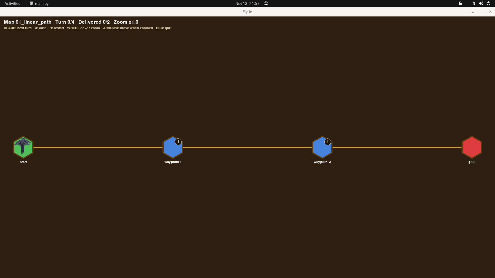

*This project has been created as part of the 42 curriculum by marasolo.*

# Fly-in

## Description

**Fly-in** routes a fleet of drones from a start zone to an end zone across a graph of zones and connections, in as few turns as possible.

The program reads a map file, computes a path for every drone, simulates the flight turn by turn and prints one line per turn. Several rules constrain the movements:

- **Zone capacity** (`max_drones`): a zone can only hold a limited number of drones at the same time (the start and end zones are unlimited).
- **Connection capacity** (`max_link_capacity`): a connection can only be used by a limited number of drones during one turn.
- **Zone types**:
  - `normal`: entered in 1 turn;
  - `priority`: entered in 1 turn, preferred zone;
  - `restricted`: entered in 2 turns (the drone is in flight for one turn);
  - `blocked`: nobody can enter it.

The project contains a parser with strict validation, a simulation engine, an independent output validator, a colored terminal output and an optional graphical replay built with pygame.

### Project structure

| File | Role |
|---|---|
| `main.py` | Entry point: parses arguments, runs the pipeline, prints the result |
| `parser.py` | `MapParser`: reads and validates the map file |
| `fly_map.py` | `FlyMap`: the graph (zones, connections, adjacency lists) |
| `zone.py` | `Zone` and `ZoneType` |
| `connection.py` | `Connection`: an undirected link with a capacity |
| `drone.py` | `Drone`: position, path and flight state |
| `pathfinder.py` | `PathFinder`: computes the paths of the drones |
| `simulation.py` | `Simulation`: turn-by-turn engine and strategy selection |
| `validator.py` | `OutputValidator`: replays an output and checks every rule |
| `renderer.py` | `TerminalRenderer`: colored terminal output |
| `gui.py` | `GraphicRenderer` and `Replay`: pygame visualization |

## Instructions

### Requirements

- Python 3.10 or later (the code uses the `X | None` syntax).
- `pygame`, only for the optional `--gui` mode.

### Installation

```bash
make install
```

This installs `flake8`, `mypy` and `pygame` with `pip`. Only `pygame` is needed to run the program (for `--gui`); the other two are used by the lint rules.

### Execution

```bash
python3 main.py <map_file> [--gui]
```

- `<map_file>`: path to a map file (exactly one is required).
- `--gui`: also opens the graphical replay after printing the turns.

### Makefile rules

| Rule | Description |
|---|---|
| `make install` | Install `flake8`, `mypy` and `pygame` |
| `make run` | Run the program on `$(MAP)` (terminal output only) |
| `make run-visual` | Run the program on `$(MAP)` with the extra arguments `$(ARGS)` (default `--gui`) |
| `make debug` | Run the program under `pdb` |
| `make lint` | Run `flake8` and `mypy` with the standard flags |
| `make lint-strict` | Run `flake8` and `mypy --strict` |
| `make clean` | Remove `__pycache__`, `.mypy_cache` and `.pytest_cache` |

The default map is `maps/easy/01_linear_path.txt`. Use another one with:

```bash
make run MAP=maps/easy/02_simple_fork.txt
make run-visual MAP=maps/easy/01_linear_path.txt
```

On an invalid map, or when no solution exists, the program prints `Error: <message>` and exits with status 1.

### Map file format

```
# This is a comment
nb_drones: 5
start_hub: hub 0 0 [color=green]
hub: roof1 3 4 [zone=restricted max_drones=2]
end_hub: goal 10 10 [color=red]
connection: hub-roof1 [max_link_capacity=2]
connection: roof1-goal
```

Rules enforced by the parser:

- `nb_drones` must be defined first, once, and be a positive integer.
- Exactly one `start_hub` and one `end_hub`; neither can be `blocked`.
- Zone line: `<name> <x> <y> [metadata]`. Names are unique, cannot contain `-`, and two zones cannot share the same coordinates.
- Zone metadata: `zone` (`normal`, `blocked`, `restricted`, `priority`), `color`, `max_drones` (positive integer, default 1).
- Connection line: `<zone1>-<zone2> [metadata]`. Both zones must already exist, a zone cannot be linked to itself, and `a-b` and `b-a` are the same connection.
- Connection metadata: `max_link_capacity` (positive integer, default 1).
- Blank lines and lines starting with `#` are ignored.
- Every error is reported with its line number.

## Algorithm choices and implementation strategy

### Overview

The problem is a multi-agent routing problem on a capacitated graph. Instead of looking for a single exact solution, the program **generates several candidate path plans, simulates each one, and keeps the fastest**.

```
map file -> MapParser -> FlyMap -> Simulation.run() -> one text line per turn
                                       |-- PathFinder.plan_paths(...)  (one plan per strategy)
                                       `-- Simulation.step()           (turn-by-turn engine)
```

### Path planning (`PathFinder`)

`PathFinder.plan_paths(nb_drones, penalty, spacing_aware)` returns one path (a list of zones from start to end) for each drone. Two parameters control how the paths are spread:

- `penalty`: the extra cost applied to a zone already used by another path. `None` forbids sharing zones, so the paths are disjoint. A number allows sharing at that price, which spreads the drones over several routes when a single route would be a bottleneck.
- `spacing_aware`: when `True`, the planner estimates the number of turns that separate two drones using the same path, so that the cost of a shared route reflects the queue it creates.

The cost of entering a zone comes from `Zone.cost()`: 2 for a restricted zone, 1 otherwise. Blocked zones are never entered.

### Strategy selection (`Simulation.run`)

`Simulation.PLANS` lists the strategies that are tried:

```
(None, False)                          no zone shared between paths
(1, True), (2, True), (3, True),
(6, True), (10, True), (20, True)      sharing allowed, with growing penalties
```

For each strategy, `play()` resets the drones, plans the paths and simulates the whole flight. `run()` keeps the result with the **fewest turns** (the first one in case of a tie). If a strategy ends in a deadlock it is skipped; if there is no path at all, the error is raised immediately; if no strategy works, the first error is reported.

### Turn engine (`Simulation.step`)

Each turn has two phases:

1. **Landings**: every drone that was in flight lands in its destination zone and uses its connection.
2. **Moves**: the other drones are processed from the most advanced on its path to the least advanced (ties broken by drone number). Making the head of the convoy move first frees room for the drones behind it. A drone moves only if the target zone has room **and** the connection is not full.
   - Normal or priority target: the drone moves immediately (`D1-a`).
   - Restricted target: the drone takes off and lands next turn (`D2-s-r`, then `D2-r`).

A drone in flight is counted in its destination zone, so its place is reserved. If a whole turn produces no movement while some drones are not delivered, the simulation reports a deadlock.

### Independent validation (`OutputValidator`)

`validator.py` replays an output line by line without using the simulation logic. It checks that drones exist and move once per turn, that connections exist, that blocked and restricted zones are handled correctly, that flights end with the announced landing, that zone and connection capacities are respected, and that all drones are delivered. This catches simulation bugs instead of repeating them.

### Design choices

- **Separation of concerns**: parsing, graph, planning, simulation, validation and display are independent modules.
- **Fail-fast parsing** with explicit messages and line numbers.
- **Multi-strategy search** as a compromise between solution quality and complexity.
- **Adjacency lists** in `FlyMap` for fast neighbor lookups.

## Visual representation

### Colored terminal output

Each movement in a turn line is colored with the `color` of its **destination zone**, as defined in the map file. Colors are enabled only when the output is a real terminal, so redirected output stays free of escape codes.

### Graphical replay (`--gui`)

A resizable pygame window replays the simulation:

- zones are drawn as hexagons, colored by their `color` metadata, with a border showing the type (gold: priority, red: restricted, black: blocked);
- a badge shows the capacity of each zone;
- the thickness of a connection reflects its `max_link_capacity`;
- drones are animated smoothly between turns, spread out when several are in the same zone, and shown halfway along the link while in flight;
- a status bar shows the map name, the current turn, the number of delivered drones and the zoom level;
- the view scales to the window and supports zoom and panning for large maps.

| Key | Action |
|---|---|
| `SPACE` | Play the next turn |
| `A` | Toggle automatic replay |
| `R` | Restart from turn 0 |
| Mouse wheel, `+` / `-` | Zoom |
| Arrow keys | Move the view when zoomed |
| `ESC` | Quit |

Example: the replay of `maps/easy/01_linear_path.txt` at turn 0 (`make run-visual MAP=maps/easy/01_linear_path.txt`).


These features make the behavior of the algorithm easy to follow: bottlenecks, queues and the use of alternative routes are visible instead of being read from text only.

## Example

### Example 1: linear path

Input (`maps/easy/01_linear_path.txt`):

```
nb_drones: 2
start_hub: start 0 0 [color=green]
hub: waypoint1 1 0 [color=blue]
hub: waypoint2 2 0 [color=blue]
end_hub: goal 3 0 [color=red]
connection: start-waypoint1
connection: waypoint1-waypoint2
connection: waypoint2-goal
```

Command:

```bash
make run MAP=maps/easy/01_linear_path.txt
```

Expected output:

```
D1-waypoint1
D1-waypoint2 D2-waypoint1
D1-goal D2-waypoint2
D2-goal
```

Each waypoint holds one drone at a time (the badge `1` in the window), so the two drones follow each other: 4 turns.

Command with the graphical replay:

```bash
make run-visual MAP=maps/easy/01_linear_path.txt
```



*Turn 0/4: both drones wait in the green start zone (drone image), the blue waypoints show their capacity badge, the red zone is the goal. The status bar shows the map, the turn, the delivered drones and the zoom, and the second line lists the keys.*

### Example 2: restricted zone

Input (`restricted.txt`):

```
nb_drones: 1
start_hub: s 0 0
hub: r 1 0 [zone=restricted]
end_hub: g 2 0
connection: s-r
connection: r-g
```

Expected output:

```
D1-s-r
D1-r
D1-g
```

The drone takes off toward `r` on turn 1, lands on turn 2, and reaches `g` on turn 3.

### Example 3: invalid map

```
nb_drones: 0
```

```
Error: line 1: nb_drones must be positive, got 0
```

## Resources

### References

- Python documentation: https://docs.python.org/3/
- pygame documentation: https://www.pygame.org/docs/
- Dijkstra's algorithm: https://en.wikipedia.org/wiki/Dijkstra%27s_algorithm
- Maximum flow and flow networks: https://en.wikipedia.org/wiki/Maximum_flow_problem
- Multi-agent pathfinding: https://en.wikipedia.org/wiki/Multi-agent_pathfinding
- ANSI escape codes: https://en.wikipedia.org/wiki/ANSI_escape_code
- PEP 8 and PEP 257 (style and docstrings): https://peps.python.org/pep-0008/

### Use of AI

AI was used as an assistant for the following tasks:

- explaining the structure and behavior of the existing modules (parser, simulation, validator, graph classes, renderer, GUI);
- reviewing the code and pointing out possible improvements;
- drafting this README.

All code was written, tested and understood by the authors.
